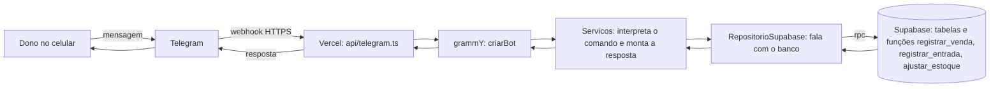
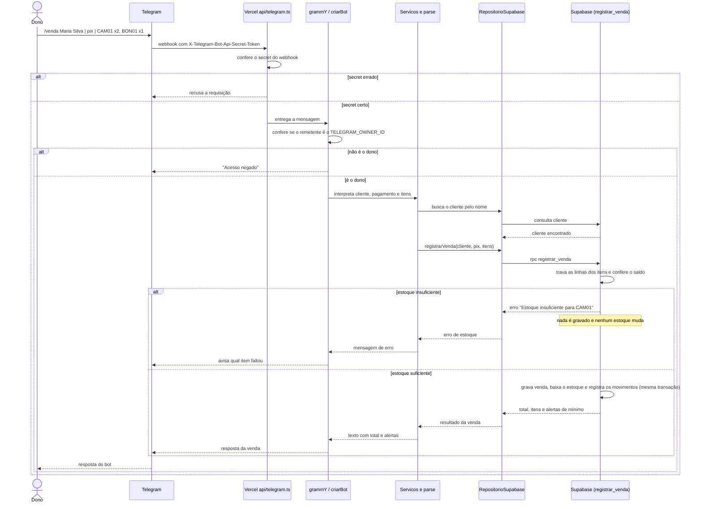

# Bot de estoque e vendas no Telegram

Este projeto é um bot do Telegram para controlar o estoque, os clientes e as vendas de uma loja pequena. Você conversa com o bot pelo celular, digitando comandos simples, e ele guarda tudo num banco de dados na nuvem.

## O que o bot faz

- **Itens:** cadastra produtos com código, nome, preço, custo, unidade e estoque mínimo.
- **Clientes:** cadastra clientes e permite buscar por nome.
- **Vendas:** registra a venda com forma de pagamento (dinheiro, pix, cartão ou fiado) e calcula o total.
- **Estoque com baixa automática:** cada venda desconta do estoque os itens vendidos, na mesma operação. Se faltar produto, a venda inteira é recusada e o bot diz qual item faltou. Nada é alterado nesse caso.
- **Alerta de mínimo:** quando um item fica com estoque igual ou abaixo do mínimo, o bot avisa logo depois da venda ou do ajuste.
- **Só o dono usa:** o bot responde apenas à conta do dono (definida pelo ID do Telegram). Qualquer outra pessoa recebe "Acesso negado".

## Comandos

Os campos de um comando são separados pelo caractere `|` (barra vertical). Não é preciso lembrar a ordem além do que está na tabela.

| Comando | Formato | Exemplo |
|---|---|---|
| /start, /ajuda | — | lista os comandos |
| /item_novo | `codigo \| nome \| preco [\| custo \| unidade \| minimo \| estoque_inicial]` | `/item_novo CAM01 \| Camiseta preta \| 49,90 \| 20 \| un \| 5 \| 30` |
| /itens | `[busca]` | `/itens cam` |
| /entrada | `codigo \| quantidade [\| motivo]` | `/entrada CAM01 \| 10 \| compra fornecedor` |
| /ajuste | `codigo \| novo_estoque [\| motivo]` | `/ajuste CAM01 \| 27 \| contagem` |
| /estoque_baixo | — | mostra os itens com estoque no mínimo ou abaixo |
| /cliente_novo | `nome [\| telefone \| obs]` | `/cliente_novo Maria Silva \| 11999990000` |
| /clientes | `[busca]` | `/clientes mar` |
| /venda | `cliente \| pagamento \| COD xQTD, COD xQTD` | `/venda Maria Silva \| pix \| CAM01 x2, BON01 x1` |
| /vendas_hoje | — | total do dia e lista das vendas |

Observações:

- Preço e custo aceitam vírgula ou ponto: `49,90` e `49.90` dão o mesmo valor.
- Na venda, use `-` no lugar do cliente para venda sem cliente. Pagamento `fiado` exige cliente.
- O nome do cliente na venda não diferencia maiúsculas de minúsculas.

## Como funciona por dentro

O bot roda na Vercel, como uma função que recebe as mensagens do Telegram. Os dados ficam no Supabase (um banco Postgres). As regras de estoque estão dentro do próprio banco, em funções SQL, o que garante que duas operações ao mesmo tempo não estraguem o saldo.



Fluxo de uma venda (`/venda`):



## Instalação passo a passo

Você vai precisar de uma conta no Telegram, uma conta no Supabase, uma conta na Vercel e uma conta no GitHub. Todas têm plano gratuito suficiente para uso pessoal.

### a. Criar o bot no Telegram

1. No Telegram, procure por **@BotFather**.
2. Envie `/newbot` e siga as perguntas (nome e um nome de usuário terminado em `bot`).
3. O BotFather devolve um **token**, parecido com `123456:ABC...`. Copie e guarde. Ele é secreto: quem tiver o token controla o bot.

### b. Descobrir seu ID do Telegram

1. No Telegram, procure por **@userinfobot** e abra a conversa.
2. Envie qualquer mensagem. Ele responde com o seu `Id`, que é um número. Guarde esse número: ele será o `TELEGRAM_OWNER_ID`.

### c. Criar o banco no Supabase

1. Entre em supabase.com e crie um **novo projeto**. Anote a senha do banco.
2. Abra o **SQL Editor** do projeto, cole o conteúdo do arquivo `supabase/migrations/0001_estoque.sql` (ele está neste repositório) e clique em **Run**. Isso cria as tabelas e as funções de estoque.
3. Vá em **Project Settings > API** e copie:
   - **Project URL**, que será o `SUPABASE_URL`;
   - **service_role key**, que será o `SUPABASE_SERVICE_ROLE_KEY`.

**Atenção:** a `service_role` key tem acesso total ao banco. Ela é secreta. Coloque-a somente nas variáveis de ambiente da Vercel. Nunca a coloque no código, no GitHub ou numa conversa.

### d. Gerar um segredo para o webhook

O segredo impede que alguém de fora finja ser o Telegram. Gere um valor aleatório no seu computador:

```bash
openssl rand -hex 32
```

Copie o resultado. Ele será o `TELEGRAM_WEBHOOK_SECRET`.

### e. Publicar na Vercel

1. Na Vercel, clique em **Add New > Project** e importe o repositório do GitHub.
2. Antes de fazer o deploy, abra **Environment Variables** e crie as 5 variáveis:

| Variável | O que colocar |
|---|---|
| `TELEGRAM_BOT_TOKEN` | o token do BotFather (passo a) |
| `TELEGRAM_OWNER_ID` | seu ID numérico do Telegram (passo b) |
| `TELEGRAM_WEBHOOK_SECRET` | o segredo gerado no passo d |
| `SUPABASE_URL` | o Project URL do Supabase (passo c) |
| `SUPABASE_SERVICE_ROLE_KEY` | a service_role key do Supabase (passo c) |

3. Clique em **Deploy**. Ao terminar, a Vercel mostra o endereço do projeto, no formato `https://SEU-PROJETO.vercel.app`.

### f. Registrar o webhook no Telegram

O webhook é o endereço para onde o Telegram envia as mensagens. Faça isso uma vez.

**Opção 1 (recomendada): pelo script do projeto.** No seu computador, dentro da pasta do projeto:

```bash
export TELEGRAM_BOT_TOKEN="cole_o_token_aqui"
export TELEGRAM_WEBHOOK_SECRET="cole_o_segredo_aqui"
npm install
npm run webhook -- https://SEU-PROJETO.vercel.app
```

No Windows (PowerShell), use `$env:TELEGRAM_BOT_TOKEN="..."` e `$env:TELEGRAM_WEBHOOK_SECRET="..."` no lugar de `export`.

**Opção 2: pelo curl**, se preferir não usar o script. Troque `<TOKEN>` e `<SEGREDO>` pelos valores reais:

```bash
curl "https://api.telegram.org/bot<TOKEN>/setWebhook" -d url=https://SEU-PROJETO.vercel.app/api/telegram -d secret_token=<SEGREDO>
```

Se der certo, o Telegram responde com `"ok": true`.

### g. Testar

No Telegram, abra a conversa com o seu bot e envie `/ajuda`. Se a lista de comandos aparecer, está funcionando. Depois, teste com um item de exemplo:

```
/item_novo CAM01 | Camiseta preta | 49,90 | 20 | un | 5 | 30
/venda - | dinheiro | CAM01 x2
```

## Desenvolvimento

Para mexer no código no seu computador:

```bash
npm install
npm run typecheck
npm test
```

- `npm run typecheck` confere os tipos do TypeScript, sem rodar o bot.
- `npm test` roda os testes automatizados (vitest).

Estrutura das pastas:

- `src/core/`: regras e textos do bot, sem falar com o banco. Inclui a interpretação dos comandos (`parse.ts`), os tipos (`tipos.ts`), os erros amigáveis (`erros.ts`) e a orquestração (`servicos.ts`).
- `src/db/`: acesso aos dados. `repo.ts` define a interface, `supabase.ts` usa o banco real e `memory.ts` é uma versão em memória, usada nos testes, com as mesmas regras.
- `src/bot/`: montagem do bot grammY (`criarBot.ts`), com a checagem do dono e os comandos.
- `api/`: a função da Vercel que recebe o webhook (`telegram.ts`).
- `scripts/`: utilitários de linha de comando, como o registro do webhook.
- `supabase/migrations/`: o SQL do banco, em ordem (`0001_estoque.sql` é o primeiro).
- `tests/`: testes automatizados.

Onde ficam as regras:

- `memoria/decisoes.md` guarda as decisões do projeto: regras de negócio, lista de comandos e contrato entre os arquivos. Antes de mudar uma regra, leia e atualize esse arquivo.
- `CLAUDE.md` e a pasta `.claude/` guardam o fluxo de trabalho com IA: um **orquestrador** (que planeja e confere) e um **executor** (que faz o trabalho braçal e devolve evidência), além das skills do projeto.

## Problemas comuns

**O bot não responde.** Confira o estado do webhook com:

```bash
curl https://api.telegram.org/bot<TOKEN>/getWebhookInfo
```

Olhe o campo `url`, que deve ser `https://SEU-PROJETO.vercel.app/api/telegram`, e o campo `last_error_message`, que mostra o erro mais recente. Se a URL estiver errada, refaça o passo f. Se houver erro de secret, confira se `TELEGRAM_WEBHOOK_SECRET` na Vercel é o mesmo usado no registro do webhook. Depois de mudar variáveis na Vercel, faça um novo deploy.

**"Acesso negado".** O `TELEGRAM_OWNER_ID` está errado. Ele precisa ser o seu ID numérico (passo b), não o nome de usuário nem o ID do bot. Corrija na Vercel e faça um novo deploy.

**"Estoque insuficiente".** Não é erro do bot. É a proteção funcionando: a venda inteira foi recusada e nenhum estoque mudou. Confira o saldo com `/itens`, faça uma `/entrada` se for o caso e tente a venda de novo.

**Alerta de estoque baixo logo após uma venda.** Também é esperado: o item chegou ao estoque mínimo que você cadastrou. Use `/estoque_baixo` para ver a lista.
